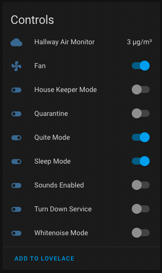
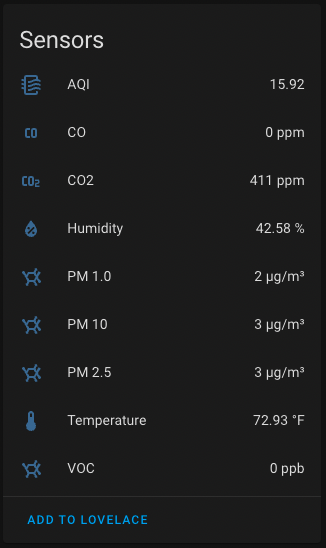

# Home Assistant Mila

**Home Assistant integration for the Mila Air Purifier.**

The [Mila Air Purifier](https://milacares.com/) is an air purifier with onboard air-quality sensors. This integration connects to Mila's cloud API and exposes each appliance to [Home Assistant](https://www.home-assistant.io/) as a fan plus a set of sensors and switches.




## Installation

### HACS

Open HACS, go to *Integrations*, click the `+` to add a new integration repository, search for `HA-mila`, and install. Restart Home Assistant.

### Manual

Copy `custom_components/mila` into your Home Assistant `custom_components/` directory and restart.

### Setup

Go to *Settings → Devices & Services → Add Integration* and pick **Mila**. Sign in with the same email and password you use in the Mila mobile app. The integration discovers every appliance on your account automatically; each one becomes a Home Assistant device with a `fan` entity plus sensors and switches.

## Entities exposed per appliance

| Platform | Examples |
|----------|----------|
| `fan` | speed (0-100 % in 10 % steps), preset modes `Automagic` / `Manual` |
| `sensor` | PM1, PM2.5, PM10, VOC, CO, CO2, temperature, humidity, AQI, fan RPM, air changes per hour, time-to-clean, Wi-Fi RSSI, filter kind, filter install/calibration dates, bedtime start/end |
| `switch` | Smart modes: Quiet, Quarantine, Child Lock, Housekeeper, Sleep, Turndown, Whitenoise |
| `select` | Sound config: Enabled / Daytime Only / Disabled |

A second device per location surfaces the nearest outdoor air-quality station (PM2.5, distance, station metadata) plus the configured pollen station.

## Services

### `mila.set_bedtime`

Set the room's nighttime window. Smart modes like Sleep and Whitenoise key off this window.

```yaml
service: mila.set_bedtime
target:
  entity_id: fan.utility_room
data:
  local_start: "22:00:00"
  local_end:   "06:30:00"
```

## Options

Per-entry options (*Configure* on the integration card):

- **Scan Interval** — seconds between polls. Defaults to 120; choose from `30`, `60`, `120`, `300`, `600`.
- **Timeout** — per-request timeout in seconds. Defaults to 30; choose from `10`, `15`, `30`, `45`, `60`.

Changes apply immediately without reloading the integration.

## Architecture

The integration is self-contained: every piece it needs lives under `custom_components/mila/`. The only runtime dependencies (declared in `manifest.json`) are `python-benedict`, `geopy`, and `python-aqi`. HTTP is handled with the `aiohttp` client that Home Assistant already provides.

```
custom_components/mila/
├── __init__.py            # async_setup_entry / async_unload_entry / options listener
├── auth.py                # HA OAuth2Session bridge using the in-tree token endpoints
├── config_flow.py         # UI config + reauth + options flows
├── update_coordinator.py  # DataUpdateCoordinator: one poll, all devices
├── fan_speed.py           # Stepped percentage <-> RPM <-> FanSpeed enum mapping
├── api/                   # Self-contained Mila GraphQL client
│   ├── auth.py            # OAuth2 password grant + refresh
│   ├── client.py          # GraphQL POST with retry; MilaApi convenience methods
│   ├── enums.py           # All Mila GraphQL enums
│   ├── exceptions.py      # MilaError, OAuthError
│   └── queries.py         # Every query/mutation string the integration sends
├── devices/               # Per-device wrappers (appliance, location)
└── entities/              # Per-platform HA entity classes
```
